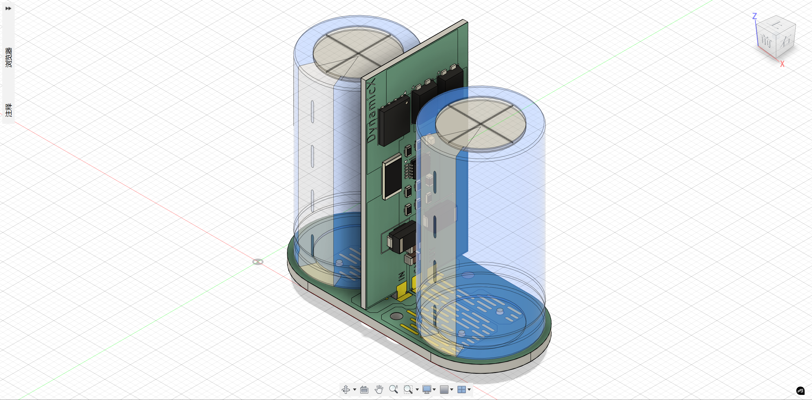
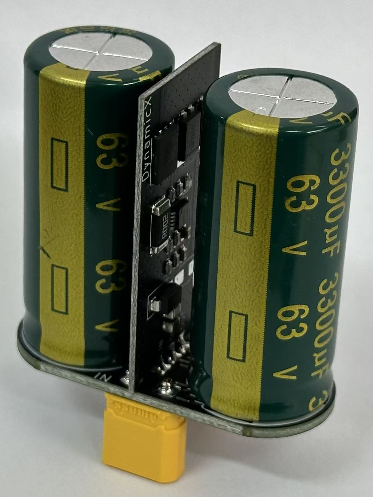
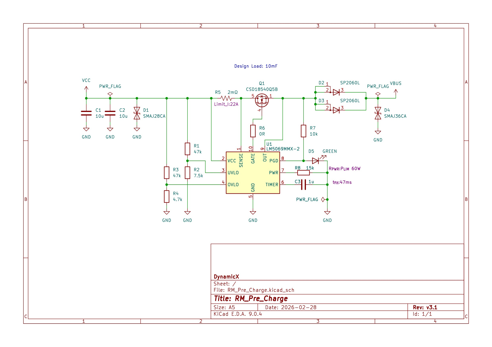
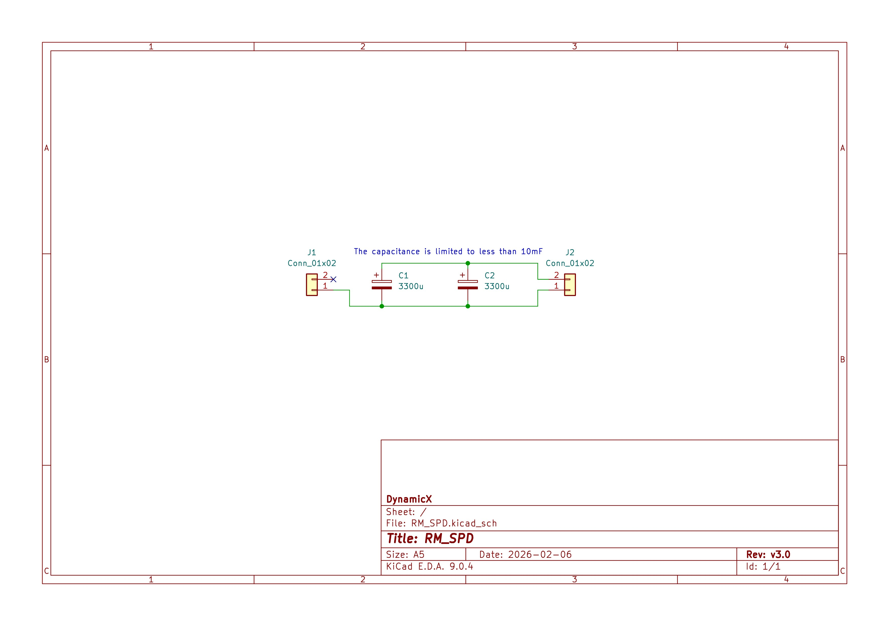
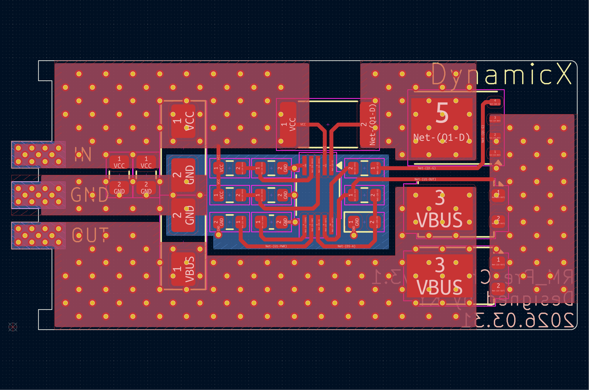
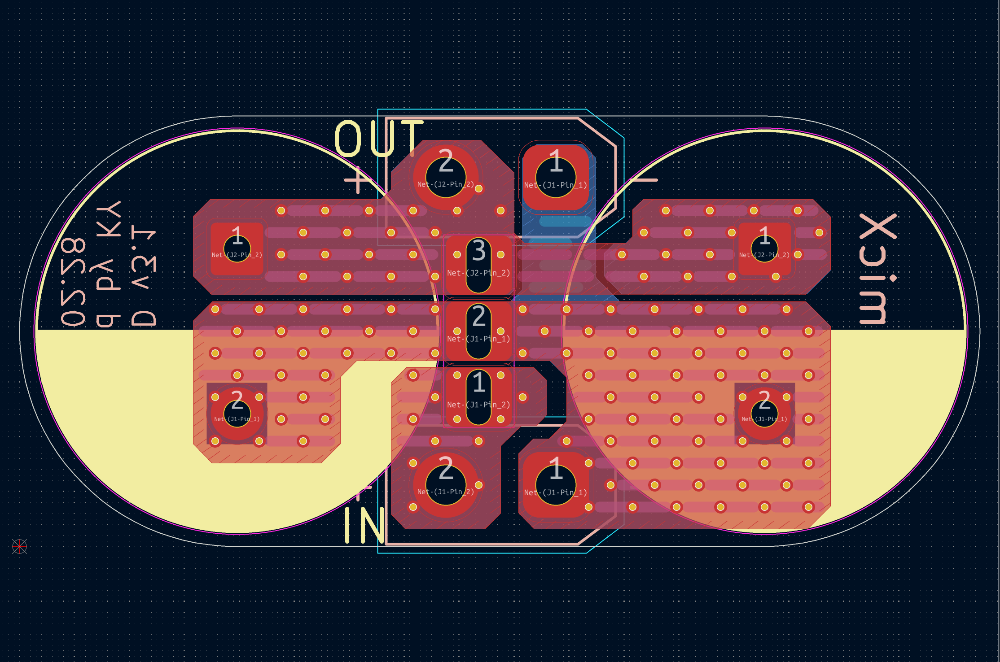

# RM_SPD

&nbsp;&nbsp;&nbsp;&nbsp;

芯片解析见[[LM5069 芯片完整讲解]]
***

### 简介

&nbsp;&nbsp;&nbsp;&nbsp;本项目的开发目的是为了在电机(主要为关节电机)需要瞬时输出较大功率时为电机负载提供较大的瞬态电流防止电池进入过流保护，在电机产生反电动势时防止电流倒灌并一定程度存储反电动势；集成了预充电功能，解决了使用DJI Martrice 4D电池上电时因容性负载过大产生过大负载电流触发保护的情况。缓启动部分基于LM5069芯片，实现了为防浪涌电容限流预充功能。LM5069芯片封装小，外围电路简单，且可保护预充MOSFET工作在SOA，是较为优秀的解决方案。下图为模块的3D图以及实物展示。

***

### 开发工具

EDA工具：KiCAD 9.0.4 (VC++ 1942, 64bit)

***

### 目录结构

circuit：基于KiCAD的原理图及PCB设计

docs：README相关的图片及文档

**注意：生产制造相关的Gerber、BOM、POS文件及程序固件均在仓库的Release中发布**

***

### 电路设计

#### 原理图设计要点

##### RM_Pre_Charge电路设计

&nbsp;&nbsp;&nbsp;&nbsp;由于DJI Martrice 4D电池短路保护为85A±10.0A(Delay time:64±20μs)，放电过流保护为27A±0.5A(Delay time:3s)，故设置电流限制为22A，能在不触发短路保护的情况下完成容性负载充电；依据LM5069数据手册，通过计算得知使用单颗CSD18540Q5B即可让MOSFET工作在SOA内为浪涌电容进行预充；根据数据手册计算输入过压欠压保护电阻及功率限制电阻；在功率路径输出侧使用两颗SP1060L肖特基二极管进行防倒灌。

##### RM_SPD电路设计

&nbsp;&nbsp;&nbsp;&nbsp;使用两颗3300uF电解电容并联作为浪涌吸收电容，并联于Pre_Charge输出侧。满足规则10mF限制。

#### PCB设计要点

##### RM_Pre_Charge的PCB布局布线要点

1. 电源输入输出接口进行开窗处理。
2. 功率路径双面铺铜并使用密集过孔连接保证一定温升下的过流能力。
3. 采样电阻与采样引脚使用开尔文连接。

##### RM_Pre_Charge的PCB布局布线要点

1. 功率路径双面铺铜并使用密集过孔连接保证一定温升下的过流能力。
2. 功率路径双面阻焊条状开窗铺锡增加导体截面积提升过流能力。

***

### 组装

#### 模块组装

1. 将Pre_Charge焊接好元元器件。
2. 将SPD进行铺锡，不焊接元器件。
3. 将Pre_Charge插入SPD后焊接。
4. 焊接浪涌吸收电容与连接器。

***

**组织：gdut-dynamicx-circuit  
维护人：柯羽, 571297898@qq.com**
